# ha-weather-card

[](https://www.home-assistant.io/integrations/marketplace/)
[](https://github.com/juju35/ha-weather-card/actions/workflows/hacs.yml)
[](https://github.com/juju35/ha-weather-card/actions/workflows/validate.yml)
[](https://github.com/juju35/ha-weather-card/actions/workflows/lint.yml)
[](https://github.com/juju35/ha-weather-card/releases/latest)
[](https://github.com/juju35/ha-weather-card/blob/main/LICENSE)
[](https://buymeacoffee.com/julienstep9)

<p align="center">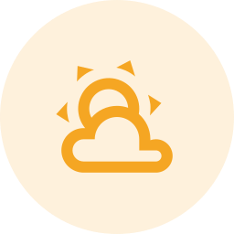</p>

<p align="center">
  &nbsp;&nbsp;
  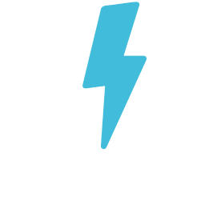&nbsp;&nbsp;
  &nbsp;&nbsp;
  &nbsp;&nbsp;
  &nbsp;&nbsp;
  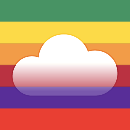&nbsp;&nbsp;
  &nbsp;&nbsp;
  &nbsp;&nbsp;
  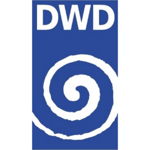&nbsp;&nbsp;
  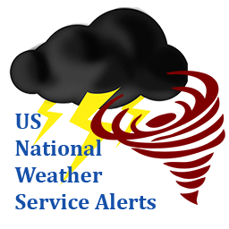&nbsp;&nbsp;
  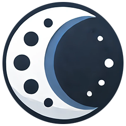
</p>

An animated weather card for Home Assistant that brings together everything the weather integrations of your instance know: the weather now and its forecasts, **rain in the next hour**, **weather warnings**, **thunderstorms and lightning nearby**, **air quality and pollutants**, **UV index**, **pollen** and **VigiEau drought restrictions**, with a mini card. Add it, it finds the weather entity and the sensors around it by itself. The sky comes alive: the sun turns, clouds drift, rain and snow fall, lightning flashes.

[](https://my.home-assistant.io/redirect/marketplace_repository/?owner=juju35&repository=ha-weather-card&category=plugin)

| Light | Dark |
|---|---|
| 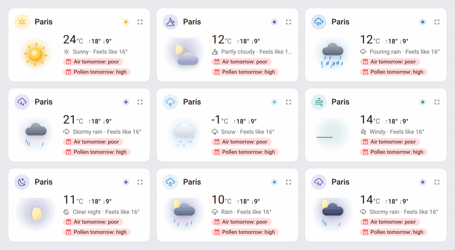 | 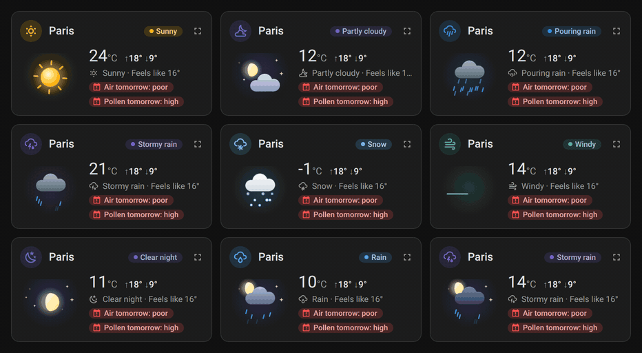 |

| Card | Type | What it shows |
|---|---|---|
| [Weather](#weather-card) | `custom:weather-plus-card` | The weather now in an animated scene, then alerts, rain in the next hour, hourly and daily forecasts, air quality, UV, pollen and sun. |
| [Weather mini](#mini-card) | `custom:weather-plus-mini-card` | The same weather on two lines, with a zoom to the full card. |

| Weather | Storm | Mini |
|---|---|---|
| 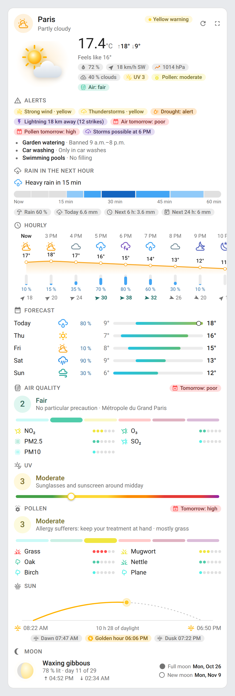 | 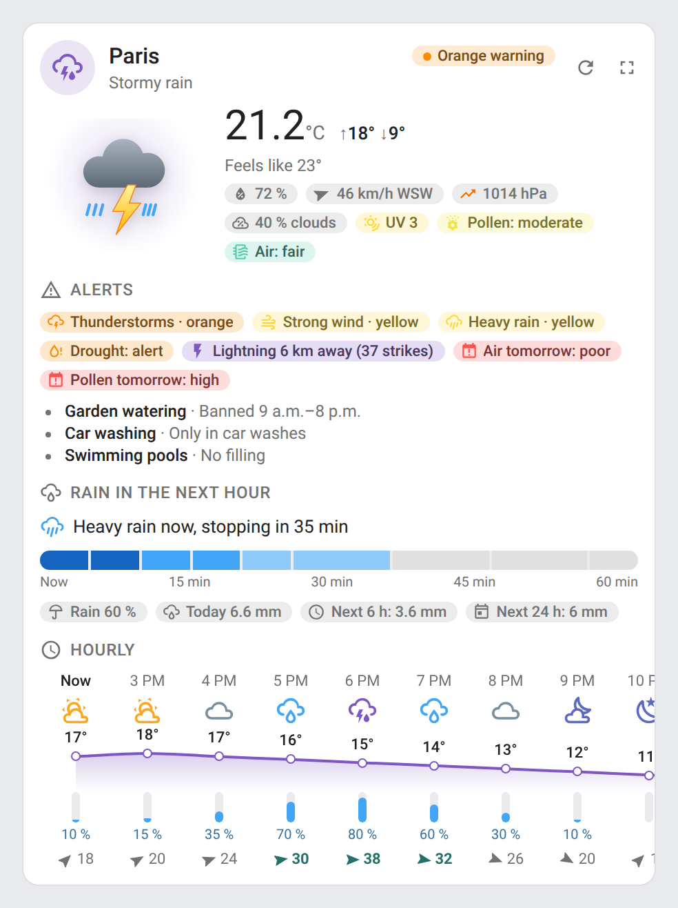 | 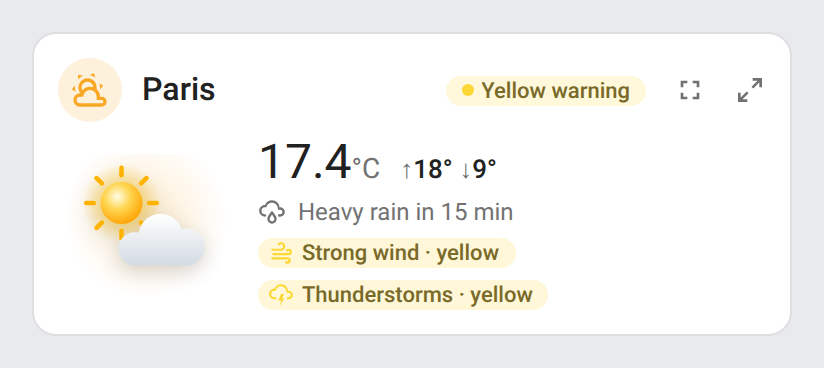 |

Like the other `ha-*` cards: header with a status pill, illustration next to the state, mini card with a detail button, a visual editor in the dashboard UI covering every option (the entity overrides in its folded **Advanced** section, as YAML), English, French, German, Spanish, Serbian (Cyrillic and Latin), Italian, Dutch, European Portuguese, Polish, Romanian, Danish, Swedish, Bulgarian, Russian, Ukrainian, Hungarian, Slovak, Czech, Slovenian, Latvian and Greek labels following the Home Assistant language, light and dark themes, a single Marketplace install with no dependency.

## Features

### Weather card

`custom:weather-plus-card` — A `weather` entity and the sensors of the weather integrations around it.

- **Animated scene** for each condition, by day and by night (from `sun.sun`): the sun's rays turn and its glow breathes, at night the moon, in its real phase, shines among twinkling stars or peeks above the rain and storm clouds, tinted for the night, clouds drift, rain falls (harder when it pours), snow flutters down, hail bounces, lightning flashes over the cloud, fog rolls and the wind blows in gusts; a warning sign for exceptional weather. `animations: false` or the system's *reduce motion* setting keeps it still. The animations pause while the card is off-screen or the browser tab is hidden, and go on when it shows again
- **Warning banner** (`warning_entities`): the warnings of Meteoalarm, DWD (Deutscher Wetterdienst), NWS alerts or Météo-France sensors under the header, one row per warning with its title, in its level's colour (yellow, orange, red), the highest first; a click opens its entity. It hides itself when there is no warning
- The temperature in large with today's high and low, the feels-like temperature, and chips for humidity, wind (an arrow turned to its direction, gusts on hover), pressure (with its 3-hour trend from the history: rising, falling or steady), cloud cover, UV index, pollen and air quality (*Pollen: low*, *Air: fair*, in the colour of their level)
- The **status pill** shows the highest weather warning (*Orange warning*, the banner's included), else lightning nearby (*Lightning 6 km away*), else the condition
- Every chip, row and reading opens the more-info dialog of its entity
- **Full screen** button (top right, `popup: false` removes it): the detail over the whole screen and its width, sections side by side as the width allows, with 24 hours and 10 days of forecast; the keyboard focus stays inside it (Tab goes round its controls); it closes with its button, Escape, a click outside or the back button on a phone, and gives the focus back to its button
- **Refresh** button (top right, `refresh: false` removes it): asks the integrations behind the card — weather, rain, alerts, sensors — for fresh data right away; the icon turns while they answer, even with `animations: false` (not with the system's *reduce motion* setting)
- In a Sections view the card takes the full width (12 columns) and goes down to 9; on a narrow card the scene gets smaller, the status pill shortens its text only when the title is down to a few letters (and on the narrowest cards shows its coloured dot only, its text in the tooltip) and the daily rows leave out their range bar

Sections, in the order of `sections` (a section with no data hides itself):

| Section | What it shows | From |
|---|---|---|
| `alerts` | Weather warnings by phenomenon in plain words with their colour (*High waves · yellow*, *Heavy rain · orange*; the official name in the tooltip), pulsing from orange; drought restrictions with their level and the restricted uses; lightning strikes and their distance; a poor air quality; thunderstorms in the hourly forecast | Météo-France *weather alert*, VigiEau, Blitzortung, the forecast |
| `rain` | Rain in the next hour as a 5-minute timeline coloured by intensity, with *Heavy rain in 15 min* / *Light rain now, stopping in 10 min*; rain, snow and frost chances; today's rainfall and the forecast totals for the next 6 and 24 hours | Météo-France *next rain*, *rain / snow / freeze chance*, *daily precipitation*, the hourly forecast |
| `hourly` | Icons by day or night, a temperature curve that draws itself, precipitation probability (or amount) bars, the wind of each hour (an arrow, its speed, the gusts on hover, strong gusts highlighted); scrolls sideways | `weather.get_forecasts` (hourly) |
| `daily` | One row a day: icon, precipitation probability, low and high on a range bar coloured by temperature against the whole week, the current temperature on today's | `weather.get_forecasts` (daily, or twice daily folded into days) |
| `air` | The air quality index (1 good … 6 extremely poor) with its advice and zone, and tomorrow's next to the title, then each pollutant — PM2.5, PM10, ozone, NO₂, SO₂ — on the six levels, the most degraded first; a poor air (level 4 and up) also shows in the alerts | Atmo France (index and pollutants), or the concentrations of WAQI, AirVisual, Google Air Quality, Airly, sensor.community… placed on the European EAQI thresholds |
| `uv` | The UV index on its scale, its level and the advice that goes with it, today's peak | A UV sensor (Météo-France, OpenUV…), else the weather entity's `uv_index` |
| `pollen` | The overall pollen risk (1 very low … 6 extremely high) with its advice and main species, and tomorrow's next to the title, then one row per species on six levels, the most present first; a high risk (4 and up) also shows in the alerts | Pollens (RNSA), Atmo France, Google Pollen, or any pollen sensor |
| `sun` | The sun's course over the day, sunrise, sunset and the daylight length; dawn, golden hour and dusk | `sun.sun`, and Home Assistant's location |
| `moon` | Today's moon drawn as it looks (mirrored south of the equator), its phase, how much of it is lit and its day in the cycle, moonrise and moonset, the next full and new moons | Computed from the date; the phase name from the [Moon](https://www.home-assistant.io/integrations/moon/) integration when it is set up; with [Lunar Phase](https://github.com/ngocjohn/lunar-phase), its phase, light, age, moonrise, moonset and next full and new moons |

### Mini card

`custom:weather-plus-mini-card` — The weather on two lines, for a compact dashboard.

- The animated scene, the temperature with today's high and low, the rain to come in the hour (or the condition and feels-like temperature), and the active warnings; the highest warning of the banner under the header
- In a Sections view its height follows its content (`rows: auto`)
- The **detail** button (top right) unfolds the full card, and back, as does a click anywhere else (`zoom: false` removes it); the unfolded card has the **Refresh** and **Full screen** buttons. When the weather is unavailable, the folded card shows the **Refresh** button too, to retry
- In a Sections view it takes 6 columns (half a section); on the narrowest sections its status pill shows its dot only, then the badge and the scene step aside for the title and the temperature

| Conditions | Night |
|---|---|
| 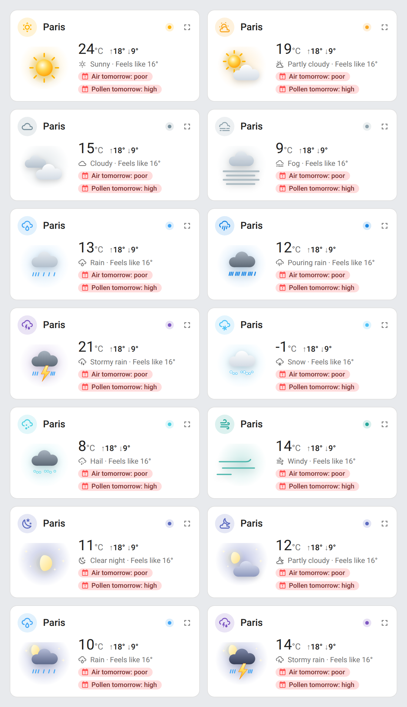 | 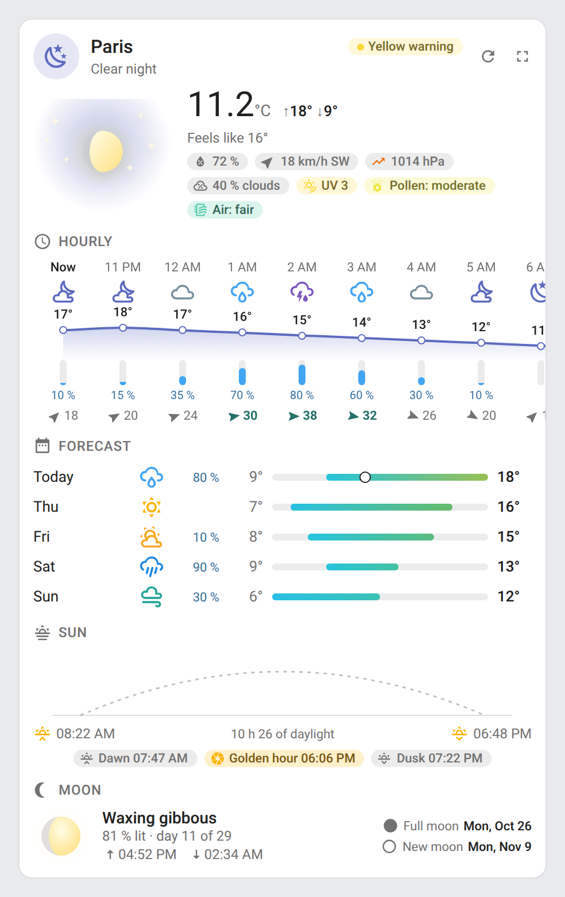 |

## Supported integrations

The card works with **any weather integration** (Météo-France, Met.no, Open-Meteo, OpenWeatherMap, Pirate Weather, AccuWeather, Met Office, Environment Canada…): the current conditions come from the `weather` entity, the forecasts from its forecast subscription (`weather.get_forecasts`), with the old `forecast` attribute as a fallback.

The other sections read the sensors of these integrations, found by their translation key, their entity id (English and French) or their attributes; the ones on the weather entity's device come first:

| Data | Integrations | Role in `entities` |
|---|---|---|
| Rain in the next hour |  [Météo-France](https://www.home-assistant.io/integrations/meteo_france/) (`sensor.*_next_rain`) | `next_rain` |
| Rain, snow, frost chances |  Météo-France | `rain_chance`, `snow_chance`, `freeze_chance` |
| Weather warnings |  Météo-France (`sensor.*_weather_alert`), Niak Weather (*Vigilance officielle*), or any sensor with a green / yellow / orange / red level per phenomenon | `alert` |
| Thunderstorms |  [Blitzortung](https://github.com/mrk-its/homeassistant-blitzortung) (`lightning_counter`, `lightning_distance`), Niak Weather (*Orage proche*), and the forecast | `lightning_counter`, `lightning_distance` |
| Drought restrictions |  VigiEau, Niak Weather (*Restrictions d'eau*, with the restricted uses), or any sensor with a *vigilance / alerte / alerte renforcée / crise* level | `vigieau` |
| UV index |  Météo-France,  [OpenUV](https://www.home-assistant.io/integrations/openuv/),  OpenWeatherMap,  Pirate Weather…, else the weather entity | `uv`, `uv_max` |
| Pollen | Pollens (RNSA),  Atmo France,  Google Pollen, any sensor named after a pollen species (levels 0–5 or 0–6, or words in French or English) | `pollen` (a list), `pollen_risk` |
| Air quality index |  Atmo France *qualité globale*, or any outdoor `aqi` sensor ( WAQI, AirVisual…); else the worst pollutant | `aqi` |
| Pollutants |  Atmo France,  WAQI, AirVisual,  Google Air Quality,  Airly, 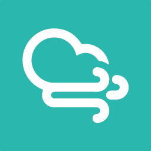 sensor.community… (an indoor purifier's PM2.5 is left out; Atmo's day-ahead *-J+1* copies too) | `air` (a map: `pm25`, `pm10`, `o3`, `no2`, `so2`) |
| Sun | `sun.sun` | `sun` |
| Cloud cover |  Météo-France *cloud cover*, else the weather entity's `cloud_coverage` | `cloud_cover` |
| Pressure trend | The weather entity's pressure sensor (else the entity itself), read from the recorder's history | `pressure` |
| Today's rainfall |  Météo-France *daily precipitation* | `daily_precipitation` |
| Tomorrow's air and pollen |  Atmo France's *-J+1* sensors next to the ones in use | — |
| Warning banner |  [Meteoalarm](https://www.home-assistant.io/integrations/meteoalarm/) (`binary_sensor`, *awareness level* and *headline*),  [DWD Weather Warnings](https://www.home-assistant.io/integrations/dwd_weather_warnings/) (current and advance warning level sensors),  [NWS Alerts](https://github.com/finity69x2/nws_alerts) (`Alerts` list, by severity),  Météo-France *weather alert* | `warning_entities` option |
| Moon phase | [Moon](https://www.home-assistant.io/integrations/moon/) (`sensor.moon_phase`), optional | `moon` |
| Moon phase, light, age, moonrise / moonset, next full and new moons |  [Lunar Phase](https://github.com/ngocjohn/lunar-phase) (its *Moon phase* sensor and its attributes), optional; it comes before Moon and the computed values, which fill in what it lacks | `lunar_phase` |

## Prerequisites

- Home Assistant 2024.8 or later with a `weather` entity

## Installation

### Via the Marketplace (recommended)

Click the button below to add the repository directly:

[](https://my.home-assistant.io/redirect/marketplace_repository/?owner=juju35&repository=ha-weather-card&category=plugin)

Then click **Install**, and reload your browser when the Marketplace asks you to.

Or manually:

1. Open **Settings → Marketplace → Add from link** (top right; this needs a GitHub account connected)
2. Add `https://github.com/juju35/ha-weather-card` — Type: **Dashboard**
3. Open **Weather Plus Card** and click **Install**
4. Clear your browser cache and refresh

### Manual

1. Download `ha-weather-card.js` and the `ha-weather-card.i18n.*.js` translation files from the [latest release](https://github.com/juju35/ha-weather-card/releases/latest)
2. Copy them all to `config/www/` (without the translation files, the cards show in English)
3. Add the resource in **Settings → Dashboards → Resources**: URL `/local/ha-weather-card.js`, type **JavaScript module**

## Configuration

Everything is optional: with no option at all, the card takes the first weather entity and every sensor it recognizes.

```yaml
type: custom:weather-plus-card
```

```yaml
type: custom:weather-plus-card
entity: weather.paris
name: Home
sections: [alerts, rain, hourly, daily, air, pollen]
hours: 18
days: 7
warning_entities:
  - binary_sensor.meteoalarm
  - sensor.berlin_current_warning_level
entities:
  uv: sensor.openuv_current_uv_index
  vigieau: sensor.alert_level_in_paris
  pollen:
    - sensor.pollens_75_graminees
    - sensor.pollens_75_bouleau
```

```yaml
type: custom:weather-plus-mini-card
entity: weather.paris
```

| Option | Type | Default | Description |
|---|---|---|---|
| `entity` | string | first `weather.*` | The weather entity |
| `name` | string | its name | Card title |
| `show_title` | boolean | `true` | Show the title in the header (e.g. `false` under a section heading of your own) |
| `show_subtitle` | boolean | `true` | Show the subtitle under the title |
| `sections` | list | `[alerts, rain, hourly, daily, air, uv, pollen, sun, moon]` | Sections shown, in this order |
| `hours` | number | `12` | Hours of the hourly forecast |
| `days` | number | `5` | Days of the daily forecast |
| `animations` | boolean | `true` | Animate the scene and the sections |
| `popup` | boolean | `true` | Full screen button that opens the detail over the whole screen |
| `refresh` | boolean | `true` | Refresh button that asks the integrations for fresh data (hidden on the folded mini card, unless the weather is unavailable) |
| `zoom` | boolean | `true` | Mini card: detail button to unfold the full card |
| `warning_entities` | list | — | Warning entities shown as a banner under the header (Meteoalarm, DWD, NWS alerts, Météo-France); hidden when none has a warning (yellow and up) |
| `entities` | map | detected | Overrides of the detected entities, by role (see [Supported integrations](#supported-integrations)) |
| `language` | string | HA language | `en`, `fr`, `de`, `es`, `sr`, `sr-Latn`, `it`, `nl`, `pt`, `pl`, `ro`, `da`, `sv`, `bg`, `ru`, `uk`, `hu`, `sk`, `cs`, `sl`, `lv` or `el` |

## Screenshots

| | Light | Dark |
|---|---|---|
| Weather card |  | 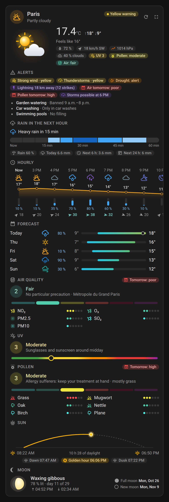 |
| Storm, orange warning |  | 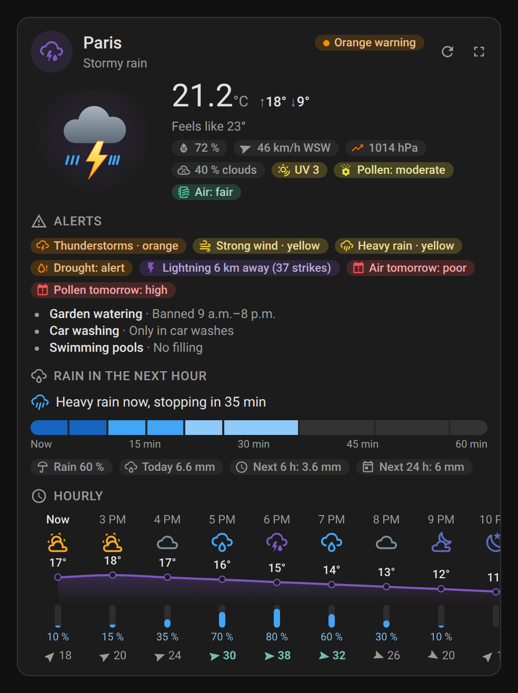 |
| Night |  | 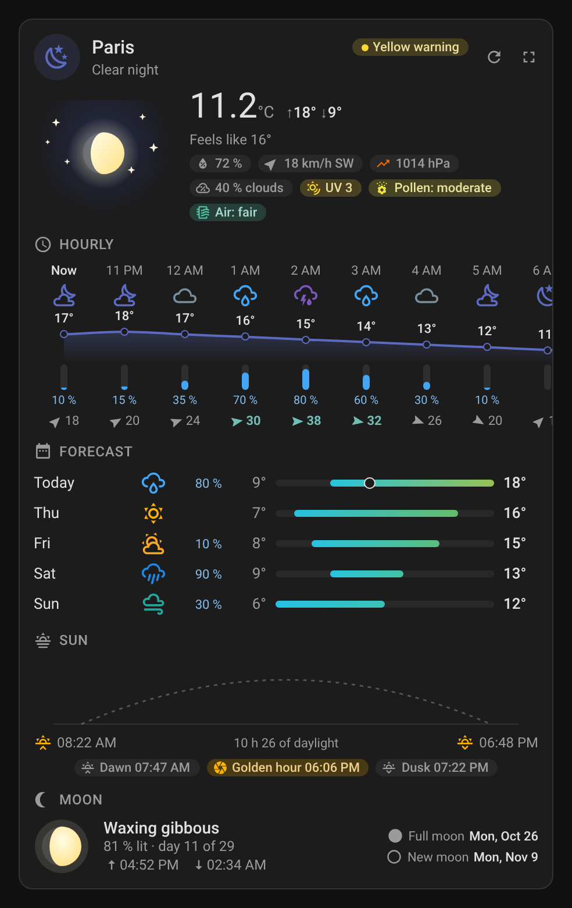 |
| Full screen | 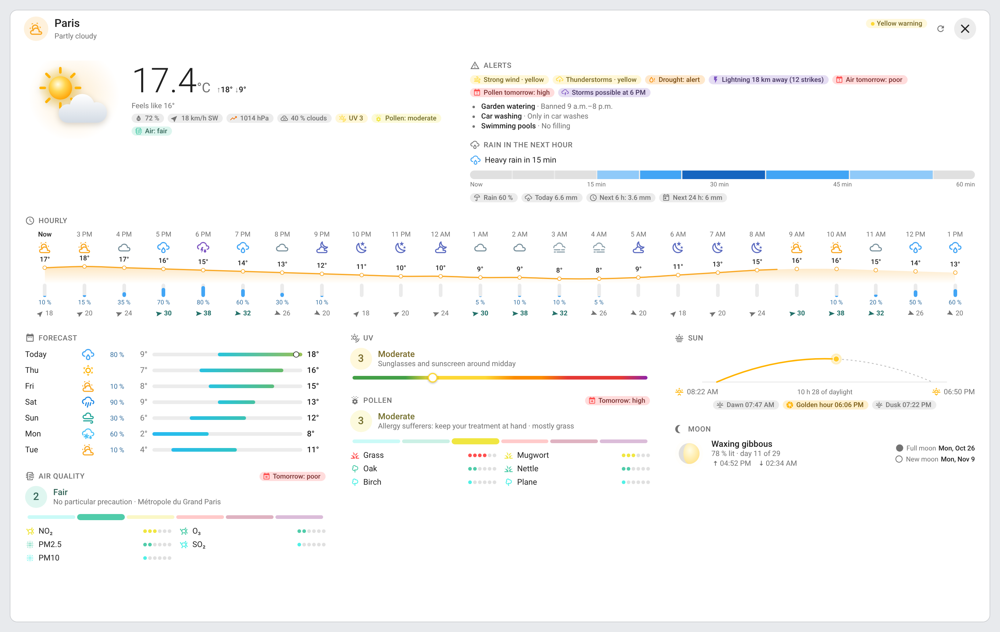 | 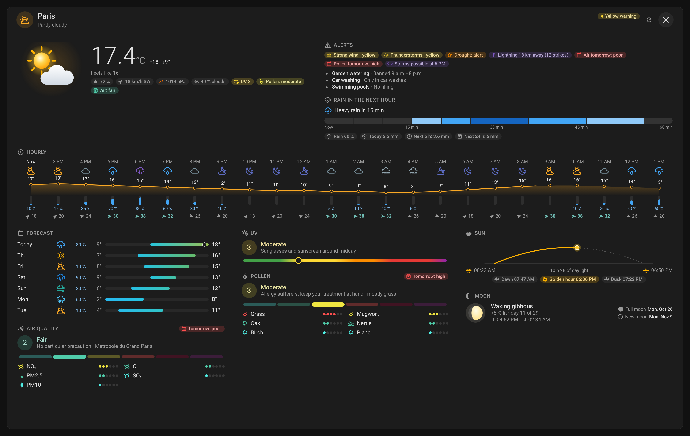 |
| Full screen, phone | 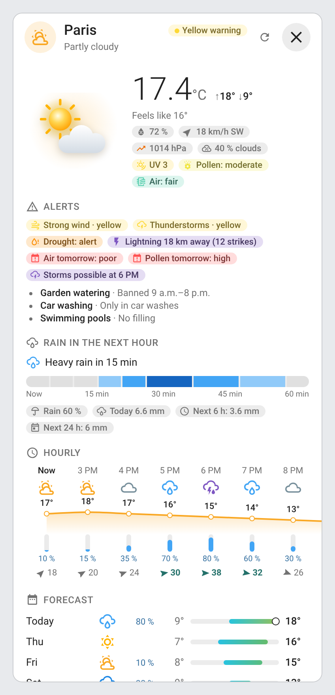 | 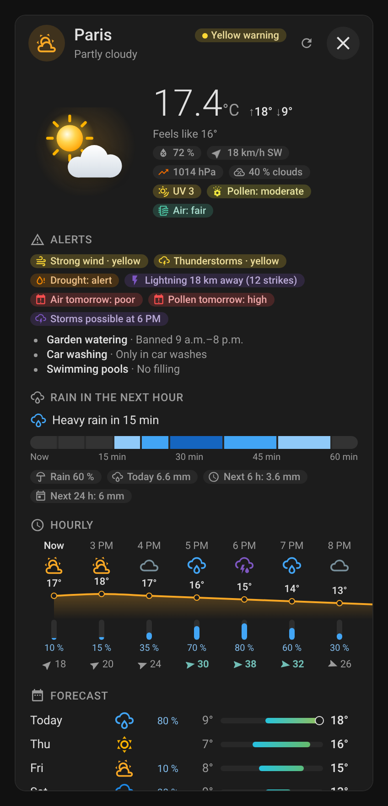 |
| Mini card |  | 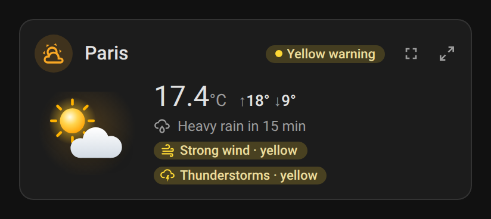 |
| Conditions |  | 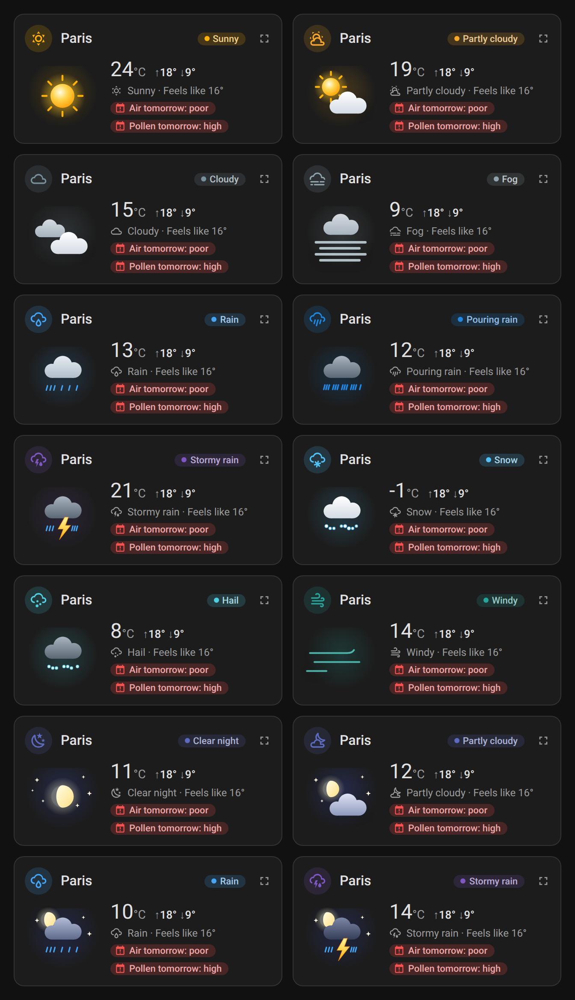 |

### Animated scenes

Each animation has its own GIF, recorded from the mini card:

| Scene | Light | Dark |
|---|---|---|
| Sunny: the sun turns and its rays pulse. | 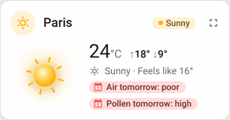 | 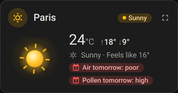 |
| Windy: clouds hurry across the sky. | 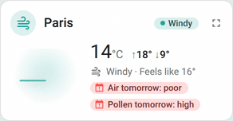 | 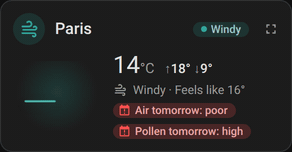 |
| Pouring: heavy rain streams under the cloud. | 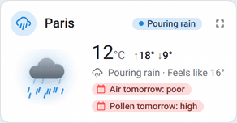 | 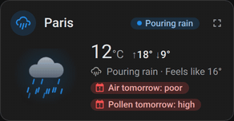 |
| Snowy: snowflakes drift down and sway. | 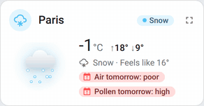 | 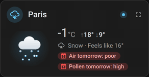 |
| Stormy rain: lightning flashes through the rain. | 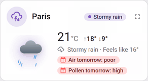 | 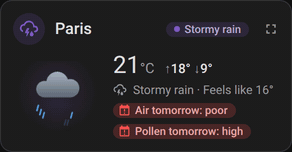 |
| Stormy rain at night: the same storm under the stars. | 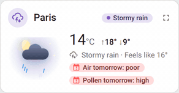 | 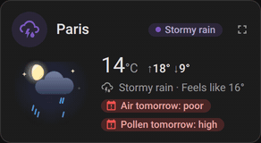 |
| Clear night: the moon shines and the stars twinkle. | 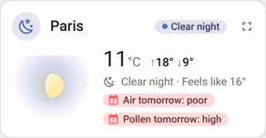 | 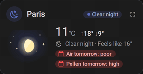 |
| Partly cloudy night: clouds drift past the moon. | 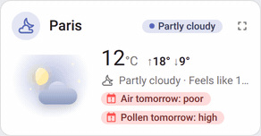 | 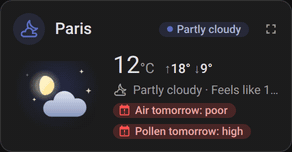 |
| Rainy night: rain falls through the moonlight. | 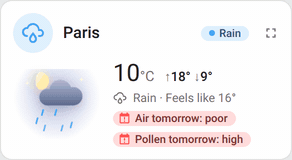 | 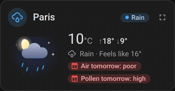 |

## Development

```bash
npm install
npm run build        # bundles src/*.js into dist/ha-weather-card.js and stamps the version of package.json
npm run check        # builds and checks the bundle (run in CI)
npm test             # unit tests, no browser
npm run screenshots  # renders the cards with mock data into screenshots/, and the animated GIFs (needs ffmpeg)
```

`src/shared.js` holds the i18n, the entity discovery, the mini card and the editor, `src/scene.js` the animated scenes, `src/sections.js` the sections and the styles, and `src/weather-plus-card.js` the cards; the build concatenates them into the single file the Marketplace installs. `dist/` is not committed: `npm run build` creates it locally, CI builds it on every push, and the release workflow attaches the built file to the release, which is where the Marketplace installs it from.

### Releasing

1. Bump `version` in `package.json`
2. Add a `## <version>` section at the top of [CHANGELOG.md](https://github.com/juju35/ha-weather-card/blob/main/CHANGELOG.md)
3. Push to `main`: the **Release** workflow builds the bundle, creates the tag and the GitHub release with the changelog section as notes, and attaches `ha-weather-card.js`

## Translations

The cards auto-detect the language from your Home Assistant settings. Currently supported:

| Language | Code |
|---|---|
| English | `en` |
| Français | `fr` |
| Deutsch | `de` |
| Español | `es` |
| Српски | `sr` |
| Srpski (latinica) | `sr-Latn` |
| Italiano | `it` |
| Nederlands | `nl` |
| Português (Portugal) | `pt` |
| Polski | `pl` |
| Română | `ro` |
| Dansk | `da` |
| Svenska | `sv` |
| Български | `bg` |
| Русский | `ru` |
| Українська | `uk` |
| Magyar | `hu` |
| Slovenčina | `sk` |
| Čeština | `cs` |
| Slovenščina | `sl` |
| Latviešu | `lv` |
| Ελληνικά | `el` |

A language with a region uses its base language (`it-IT` gives Italian); Brazilian Portuguese (`pt-BR`) falls back on European Portuguese.

Contributions for additional languages are welcome!

## License

[MIT](https://github.com/juju35/ha-weather-card/blob/main/LICENSE)

## Support

If you find this project useful, you can support its development:

<a href="https://buymeacoffee.com/julienstep9"></a>
